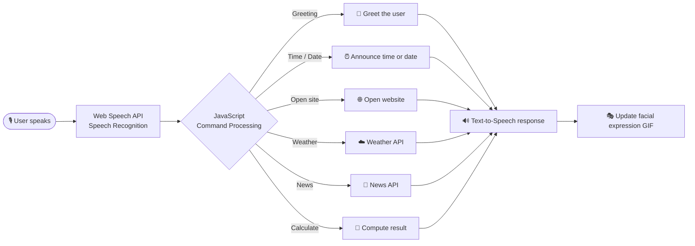

<div align="center">


# 🌙 Luna – Virtual Voice Assistant 🎙️

### *Meet Luna – your friendly virtual voice assistant!*

<p>
  
  
  
  
  
</p>

<p>
  <a href="https://github.com/ankita-codeshub/Simple-Voice-Virtual-Assistant/stargazers"></a>
  <a href="https://github.com/ankita-codeshub/Simple-Voice-Virtual-Assistant/network/members"></a>
  <a href="https://github.com/ankita-codeshub/Simple-Voice-Virtual-Assistant/issues"></a>
  <a href="#-license"></a>
  
</p>

**🎙️ Listen &nbsp;•&nbsp; 🔊 Speak &nbsp;•&nbsp; 🌐 Browse &nbsp;•&nbsp; ☁️ Weather &nbsp;•&nbsp; 📰 News &nbsp;•&nbsp; 🧮 Calculate &nbsp;•&nbsp; 🎭 Express**

</div>

---

## 🧭 Navigation

<div align="center">

| | | | |
|:---:|:---:|:---:|:---:|
| [📖 About](#-about) | [🚀 Features](#-features) | [🎬 Preview](#-preview) | [🛠️ Tech Stack](#️-tech-stack) |
| [🔄 Workflow](#-workflow) | [📂 Structure](#-project-structure) | [🎭 Expressions](#-dynamic-facial-expressions) | [🎤 Commands](#-supported-voice-commands) |
| [💻 Setup](#-how-to-run-locally) | [🌟 Roadmap](#-future-improvements) | [👩‍💻 Contributing](#-contributing) | [🙏 Credits](#-acknowledgements) |

</div>

---

## 📖 About

> **Luna** is a smart and interactive **Virtual Voice Assistant** built using **HTML, CSS and JavaScript**.

Luna listens to your voice commands, responds through speech, opens websites, provides weather updates, fetches the latest news, performs calculations and more.

She also features **dynamic facial expressions** using GIF animations, making every interaction more engaging and user-friendly. 🎭

---

## 🚀 Features

| Icon | Feature | Description |
|:---:|---|---|
| 🎙️ | **Voice Recognition** | Interact with Luna using natural voice commands |
| 🔊 | **Speech Response** | Luna replies using text-to-speech technology |
| 🌐 | **Website Navigation** | Open Google, YouTube, Instagram, Facebook and WhatsApp |
| ⏰ | **Time & Date** | Get the current time and date by voice |
| ☁️ | **Live Weather Updates** | Check weather information for different cities |
| 📰 | **Latest News** | Get the latest news updates for a selected city |
| 🧮 | **Calculator** | Perform mathematical calculations with voice commands |
| 🤖 | **Dynamic Expressions** | Luna shows different emotions using animated GIFs |
| 🎨 | **Interactive UI** | User-friendly interface with animations and visual feedback |

---


## 🛠️ Tech Stack

| Technology | Purpose |
|:---|:---|
|  | Structure of the application |
|  | Styling, layout, and animations |
|  | Core functionality and command processing |
|  | Speech recognition and text-to-speech |
|  | Weather information |
|  | Latest news updates |

---

## 🔄 Workflow



---

## 📂 Project Structure

<details open>
<summary><b>Click to expand / collapse</b></summary>

```text
Simple-Voice-Virtual-Assistant/
│
├── index.html
├── style.css
├── script.js
├── server.js
├── sw.js
├── manifest.json
├── package.json
│
├── logo.jpg
├── luna logo.png
├── mic.svg
├── mic1.svg
├── voice.gif
├── voice.svg
│
├── faces/
│   ├── angry.gif
│   ├── coming.gif
│   ├── excited.gif
│   ├── happy.gif
│   ├── interesting.gif
│   ├── sad.gif
│   └── sleeping.gif
│
└── README.md
```

> 📝 **Note:** This structure represents the project files. Some optional files may vary depending on your local setup.

</details>

---

## 🎭 Dynamic Facial Expressions

Luna uses **animated GIFs** to express different moods and reactions. You can customise the expressions by replacing or adding GIF files inside the `faces` folder.

| 😠 | 🚶 | 🤩 | 😊 | 🤔 | 😢 | 😴 |
|:---:|:---:|:---:|:---:|:---:|:---:|:---:|
| `angry` | `coming` | `excited` | `happy` | `interesting` | `sad` | `sleeping` |

**Example in JavaScript**

```javascript
// Change Luna's expression dynamically
setBotMood("happy");
setBotMood("sad");
```

> 💡 The expression changes according to the mood selected by the application.

---

## 🎤 Supported Voice Commands

| 🗣️ Voice Command | ⚡ Action |
|:---|:---|
| `Hi Luna` / `Hello` | Luna greets the user |
| `What time is it?` | Announces the current time |
| `What's today's date?` | Announces the current date |
| `Open YouTube` | Opens YouTube |
| `Open Google` | Opens Google |
| `Open WhatsApp` | Opens WhatsApp Web |
| `Open Instagram` | Opens Instagram |
| `Weather in [city]` | Provides weather information |
| `News in [city]` | Provides news updates |
| `Calculate 12 plus 5` | Calculates and announces the result |

---

## 💻 How to Run Locally

Follow these steps to run Luna on your computer.

### 1️⃣ Clone the repository

```bash
git clone https://github.com/ankita-codeshub/Simple-Voice-Virtual-Assistant.git
```

### 2️⃣ Navigate to the project folder

```bash
cd Simple-Voice-Virtual-Assistant
```

### 3️⃣ Install dependencies *(if required)*

```bash
npm install
```

### 4️⃣ Run the application

If the project uses a Node.js server, use the start command configured in `package.json`:

```bash
# [PLACEHOLDER: replace with the start command from your package.json]
```

Alternatively, open `index.html` using the **VS Code Live Server** extension if your setup supports direct browser execution.

### 5️⃣ Start interacting with Luna! 🌙

Allow **microphone access** when prompted and try the supported voice commands.

<details>
<summary><b>🔑 API configuration (Weather & News)</b></summary>

<br />

Luna uses a Weather API and a News API. Add your own keys where the project expects them:

- Weather API provider: `[PLACEHOLDER: provider name]`
- News API provider: `[PLACEHOLDER: provider name]`
- Where to add your keys: `[PLACEHOLDER: file / variable name]`

> ⚠️ Never commit your private API keys to a public repository.

</details>

---

## 🌟 Future Improvements

- [ ] Add offline voice recognition
- [ ] Develop a mobile application
- [ ] Integrate AI-powered conversational responses
- [ ] Add customisable voice packs
- [ ] Improve multilingual voice interaction
- [ ] Introduce more facial expressions and animations

---

## 👩‍💻 Contributing

Contributions are welcome! 🎉 If you want to improve Luna or add new features:

1. **Fork** this repository
2. **Create** a new branch

   ```bash
   git checkout -b feature-name
   ```

3. **Make** your changes
4. **Commit** your changes

   ```bash
   git commit -m "Add new feature"
   ```

5. **Push** your branch

   ```bash
   git push origin feature-name
   ```

6. **Open** a Pull Request

---

## 🙏 Acknowledgements

- 🎙️ [Web Speech API](https://developer.mozilla.org/en-US/docs/Web/API/Web_Speech_API)
- 🔤 [Google Fonts](https://fonts.google.com/)
- ☁️ Weather and news API providers

---

## 📄 License

This project is licensed under the **MIT License**.

You are free to use, modify, and distribute this project according to the terms of the license.

---

## 👤 Author

<div align="center">

**Ankita**

<a href="https://github.com/ankita-codeshub"></a>
<a href="https://github.com/ankita-codeshub/Simple-Voice-Virtual-Assistant"></a>

</div>

---

<div align="center">

### ⭐ If you like Luna, give this repository a star! ⭐

**Thank you for visiting! 💜**

Made with ❤️ by **Ankita**

🌙 *Meet Luna – Your friendly virtual voice assistant!*

</div>
